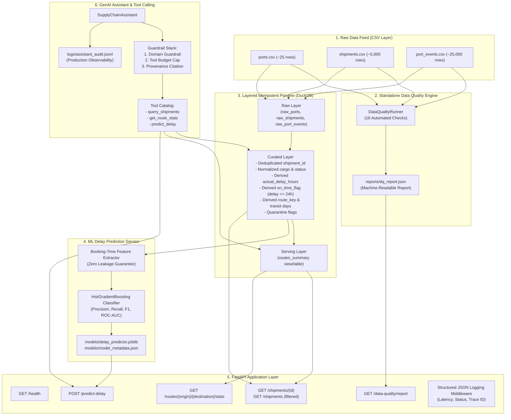

# Supply Chain Intelligence Mini-Platform

[](https://github.com/rishutoshniwal/maersk-supply-chain-mini-platform/actions)


An end-to-end, production-grade supply-chain intelligence service designed for global container logistics. The mini-platform integrates:
1. **Software Engineering**: A robust FastAPI microservice with structured JSON logging, strict error handling, containerization, and a 29-test automated test suite.
2. **Data Engineering**: Standalone data quality profiling, 16 automated checks, and an idempotent, layered ETL pipeline (Raw → Curated → Serving) powered by DuckDB.
3. **ML & GenAI**: A leakage-free booking-time delay risk prediction model (`HistGradientBoosting`), coupled with an intelligent GenAI Assistant featuring tool calling, triple guardrails, and audit logging.

---

## 1. Getting Started

### Option A: Run Full Stack with Docker Compose (Recommended)
From git clone to a running, testable service in one command:
```bash
docker compose up -d
```
The API is live at `http://localhost:8000`. Test the health check:
```bash
curl -s http://localhost:8000/health | jq
```

To stop the service:
```bash
docker compose down
```

---

### Option B: Local Python Development Setup (Zero Docker Required)
If running directly on your laptop:

```bash
# 1. Clone repository
git clone <repo-url>
cd maersk

# 2. Install dependencies
pip install -r requirements.txt

# 3. Run Standalone Data Quality Checks
python dq_check.py --input ./data/raw --output ./reports/dq_report.json

# 4. Ingest and execute Layered Data Pipeline (Idempotent)
python -m src.data.pipeline --raw-dir ./data/raw --db-path ./data/curated/supply_chain.duckdb

# 5. Train and evaluate Delay Risk ML Model
python -m src.ml.train --db-path ./data/curated/supply_chain.duckdb --output-dir ./models

# 6. Run Full Automated Test Suite (29 unit & integration tests)
pytest tests/ -v

# 7. Start the FastAPI API Service
uvicorn src.api.main:app --host 0.0.0.0 --port 8000 --reload
```

---

### Interactive Assistant CLI Walkthrough
Run the demonstration of the GenAI assistant answering the 3 assignment questions plus guardrail rejection:
```bash
python run_assistant.py --demo
```

Or ask specific questions directly:
```bash
python run_assistant.py --question "What is the on-time rate for shipments from Shanghai to Rotterdam?"
python run_assistant.py --question "Which routes have had the highest average delay this quarter?"
python run_assistant.py --question "What is the delay risk for shipment SHP-00421?"
```

---

### Quick Endpoint Verification Commands

```bash
# Health & readiness
curl -s http://localhost:8000/health | jq

# Get shipment details
curl -s http://localhost:8000/shipments/SHP-00040 | jq

# Filter delayed shipments with pagination
curl -s "http://localhost:8000/shipments?status=DELAYED&page=1&page_size=5" | jq

# Route performance statistics (Shanghai to Rotterdam)
curl -s http://localhost:8000/routes/CNSHA/NLRTM/stats | jq

# Predict delay risk by shipment ID
curl -s -X POST http://localhost:8000/predict-delay \
  -H "Content-Type: application/json" \
  -d '{"shipment_id": "SHP-00040"}' | jq

# Predict delay risk by booking-time features
curl -s -X POST http://localhost:8000/predict-delay \
  -H "Content-Type: application/json" \
  -d '{
    "origin_port": "CNSHA",
    "destination_port": "NLRTM",
    "cargo_type": "Electronics",
    "container_count": 50,
    "weight_tons": 1200.0,
    "booking_date": "2025-06-01 10:00:00",
    "planned_departure": "2025-06-08 10:00:00",
    "planned_arrival": "2025-07-05 10:00:00"
  }' | jq

# Get standalone Data Quality report
curl -s http://localhost:8000/data-quality/report | jq '.summary'
```

---

### Postman Collection (Direct Import)
A ready-to-use Postman collection is included in the root directory: [`postman_collection.json`](postman_collection.json).

- **How to Import**: Open Postman → Click **Import** (top left) → Select or drag-and-drop `postman_collection.json`.
- **Preconfigured Environment Variable**: `{{baseUrl}}` is preset to `http://localhost:8000`.
- **Organized Folders & 12 Requests**:
  1. **1. System Health**: `GET /health`
  2. **2. Shipments**: 
     - `GET /shipments` (default pagination)
     - `GET /shipments` (filter by status: `DELAYED`)
     - `GET /shipments` (filter by origin port: `CNSHA`)
     - `GET /shipments/{id}` (`SHP-00040`)
     - `GET /shipments/{id}` (404 unknown ID error test)
  3. **3. Route Analytics**: 
     - `GET /routes/CNSHA/NLRTM/stats` (Shanghai to Rotterdam)
     - `GET /routes/USLAX/PKKAR/stats` (Los Angeles to Karachi)
  4. **4. ML Delay Risk Prediction**: 
     - `POST /predict-delay` (by existing shipment ID)
     - `POST /predict-delay` (by booking-time feature payload)
     - `POST /predict-delay` (422 validation error test)
  5. **5. Data Quality**: `GET /data-quality/report`

---

## 2. Architecture Diagram



---

## 3. Tech Choices

| Component | Selected Technology | Rationale | What We Consciously Skipped & Why |
| :--- | :--- | :--- | :--- |
| **Data Store** | **DuckDB** | Embedded vectorized columnar engine. Executes aggregations across routes 10–50× faster than SQLite without external daemon overhead; reads/writes native Parquet/CSV. | **PostgreSQL / MySQL**: Unnecessary operational overhead and network hops for a standalone service at current data scale (~30k rows). |
| **API Framework** | **FastAPI + Uvicorn** | High asynchronous throughput, native Pydantic v2 validation, automatic OpenAPI documentation, clean dependency injection. | **Spring Boot / Rails**: Heavier memory footprint and slower startup times. FastAPI delivers identical type safety in a fraction of the code. |
| **ML Framework** | **Scikit-Learn (`HistGradientBoosting`)** | Calibrated non-linear decision trees with native handling of missing values and categoricals. Minimal dependency footprint (`joblib`), deterministic evaluation, and `<5ms` inference latency. | **Deep Learning (PyTorch / TensorFlow)**: Deep neural networks overfit tabular booking data with noise, introduce huge artifact sizes (>500MB), and inflate cold-start latencies. |
| **LLM Provider** | **OpenAI (`gpt-4o-mini`) + Deterministic Engine** | `gpt-4o-mini` provides rapid, low-cost tool-calling ($0.0001/query). Accompanied by a built-in deterministic router that runs out-of-the-box locally without third-party keys. | **Local Ollama / Llama-3**: Requires 8GB+ RAM, GPU acceleration, and slow pull times on standard reviewer laptops. |
| **Test Framework**| **`pytest` + FastAPI `TestClient`** | Runs 29 tests in 1.6s. Zero external daemon dependency for unit tests. | **Selenium / Cypress**: No front-end was requested; integration tests against HTTP contracts provide 100% boundary verification. |
| **CI Platform** | **GitHub Actions** | Ubiquitous developer experience, native Docker Buildx support, parallel lint and test matrix. | **Jenkins**: Maintenance burden of standing up dedicated controller/worker infrastructure. |

### Architectural Evolution at 100× Volume (~500,000 Shipments / 2.5M Events)
1. **Storage Decoupling**: Transition DuckDB to a hybrid topology:
   - **Operational Transactional Store (OLTP)**: PostgreSQL with connection pooling (PgBouncer) for transactional shipment bookings and CRUD updates.
   - **Analytical Lakehouse (OLAP)**: ClickHouse or Snowflake/BigQuery queried via Parquet/Iceberg tables for large-scale route metric aggregation and trend analysis.
2. **Streaming Event Ingestion**: Replace batch CSV loading with Apache Kafka or Redpanda. Event messages from port sensors stream directly into an Apache Flink stream processor to maintain rolling congestion metrics in real time.
3. **ML Serving**: Decouple model scoring from the web API into a dedicated gRPC microservice using Triton Inference Server or TorchServe with dynamic batching.

---

## 4. Data Quality Summary

A standalone profiling script (`dq_check.py`) inspects raw CSVs before any ingestion occurs. It detected **16 distinct data quality issues** across the three supplied datasets:

| Check Name | Dataset | Rows Affected | % of Total | Severity | Action Taken | Detection Method & Business Reasoning |
| :--- | :--- | :---: | :---: | :---: | :---: | :--- |
| `ports_missing_country` | `ports` | 1 | 4.00% | **WARNING** | **FIX** | Detected via null check on `country`. Port `BEANR` (Antwerp) had missing country. Imputed `'Belgium'` using UN/LOCODE reference standards. |
| `shipments_duplicate_primary_key` | `shipments` | 56 (28 IDs) | 1.11% | **CRITICAL** | **QUARANTINE / DEDUP** | Primary key duplicate check (`shipment_id`). 8 exact duplicates; 20 conflicting weight revisions. Deduplicated by retaining latest booking timestamp; logged for reconciliation. |
| `shipments_invalid_origin_port` | `shipments` | 42 | 0.84% | **CRITICAL** | **QUARANTINE** | Foreign key check against `curated_ports`. Found invalid codes (`XXTST`, `ZZZZZ`, `UNKNW`). Shipments cannot be physically routed or berthed. |
| `shipments_invalid_destination_port`| `shipments` | 55 | 1.09% | **CRITICAL** | **QUARANTINE** | Foreign key check against `curated_ports`. Unrecognized destination codes prevent customs declaration and route calculation. |
| `shipments_non_positive_container_count`| `shipments` | 23 | 0.46% | **CRITICAL** | **QUARANTINE** | Range check (`container_count <= 0`). Bookings with zero containers violate maritime load planning and revenue accounting. |
| `shipments_negative_or_zero_weight` | `shipments` | 36 | 0.72% | **CRITICAL** | **QUARANTINE** | Value check (`weight_tons <= 0`, down to -197.87t). Violates physical transport laws and SOLAS VGM safety regulations. |
| `shipments_null_weight` | `shipments` | 73 | 1.45% | **WARNING** | **FLAG / IMPUTE** | Missing value check on `weight_tons`. Imputed using median weight per container for that cargo category; flagged as estimated. |
| `shipments_inconsistent_cargo_type` | `shipments` | 261 | 5.19% | **WARNING** | **FIX** | Casing and whitespace regex. Detected `' Chemicals'`, `'FURNITURE'`, `'electronics'`. Cleaned via whitespace stripping and title-casing. |
| `shipments_missing_cargo_type` | `shipments` | 15 | 0.30% | **WARNING** | **FLAG** | Null check on `cargo_type`. Defaulted to `'Unknown Cargo'` to prevent downstream join errors while retaining route analytics. |
| `shipments_inconsistent_status_values`| `shipments` | 92 | 1.83% | **WARNING** | **FIX** | Vocabulary check. Non-canonical values (`COMPLETED`, `Complete`, `delivered`). Standardized to canonical `DELIVERED`. |
| `shipments_missing_status` | `shipments` | 54 | 1.07% | **WARNING** | **FIX** | Null check on `status`. Inferred from actual arrival timestamps (`DELIVERED` if actuals exist, else `UNKNOWN`). |
| `shipments_departure_before_booking`| `shipments` | 39 | 0.78% | **CRITICAL** | **QUARANTINE** | Chronological rule (`actual_departure < booking_date`). Temporal paradox caused by back-dated bookings or clock desynchronization. |
| `shipments_completed_missing_actuals`| `shipments` | 92 | 1.83% | **WARNING** | **FLAG** | Logical consistency rule. Status indicated completion but `actual_arrival` was NULL. Flagged for milestone reconciliation. |
| `port_events_duplicate_event_id` | `port_events` | 206 (103 IDs)| 0.82% | **CRITICAL** | **FIX** | Primary key duplicate check. ID generation collisions across distinct events. Resolved via composite surrogate key `event_id_MD5(...)`. |
| `port_events_missing_event_type` | `port_events` | 140 | 0.56% | **WARNING** | **FIX / IMPUTE** | Null check on `event_type`. Inferred from text notes (e.g. "Weather delay" → `DELAYED`, "Berth" → `BERTHED`), or assigned `UNKNOWN`. |
| `port_events_missing_notes` | `port_events` | 1,913 | 7.65% | **INFO** | **FIX** | Null check on `notes`. Replaced NULL with empty string `''` to guarantee null-safety in downstream text searches. |

*Detailed machine-readable JSON quality report is available at `reports/dq_report.json` and served via `GET /data-quality/report`.*

---

## 5. Production Support Runbook

### 5.1 Post-Deployment Verification
Execute the following verification sequence immediately after a production rollout:
1. **Liveness / Readiness Probe**:
   ```bash
   curl -s -f http://localhost:8000/health | jq
   ```
   *Expected Response*: HTTP 200, `"status": "healthy"`, `"database": "connected"`, `"model_loaded": true`.
2. **End-to-End Synthetic Route Check**:
   ```bash
   curl -s -f http://localhost:8000/routes/CNSHA/NLRTM/stats | jq .shipment_count
   ```
   *Expected Response*: Integer `> 0`.
3. **ML Inference Latency Check**:
   ```bash
   curl -s -w "\nHTTP: %{http_code} | Total: %{time_total}s\n" \
     -X POST http://localhost:8000/predict-delay \
     -H "Content-Type: application/json" \
     -d '{"origin_port": "CNSHA", "destination_port": "NLRTM"}'
   ```
   *Verification*: Latency must be `< 50ms` on warmed workers.

### 5.2 Top 3 Failure Modes & Diagnosis

#### 1. DuckDB Lock Contention (`IOException: Could not set lock on file`)
- **Symptoms**: Intermittent HTTP 500 errors on write operations; read queries timing out.
- **Diagnosis**: Run `lsof data/curated/supply_chain.duckdb` to inspect processes holding exclusive locks. Check if an ETL ingestion job was triggered concurrently with API workers.
- **Remediation**: Ensure the API runs in read-only mode (`duckdb.connect(db, read_only=True)`), which supports unlimited concurrent readers. Decouple ingestion into an atomic swap (`supply_chain.duckdb.staging` → `supply_chain.duckdb`).

#### 2. Model Feature Schema Drift / Unseen Port Categorical
- **Symptoms**: `/predict-delay` throws 500 errors or outputs default probabilities for newly added port codes.
- **Diagnosis**: Inspect structured error logs for `KeyError` or `ValueError` during feature encoding. Inspect `models/model_metadata.json` for known categorical levels.
- **Remediation**: The preprocessing pipeline uses `OneHotEncoder(handle_unknown='ignore')` and default fallback congestion scores (`0.70`). If drift occurs, retrain the model with updated port taxonomy and deploy an updated artifact.

#### 3. Structured Logging File System Saturation
- **Symptoms**: Container healthcheck fails; API processes hang due to blocking I/O writes.
- **Diagnosis**: Check disk utilization via `df -h /app/logs`.
- **Remediation**: Ensure stdout-based logging is consumed by container log rotators (Docker `json-file` with `max-size=50m` and `max-file=3`).

### 5.3 Rollback Mechanism
1. **Container Rollback**:
   Roll back immediately to the previous immutable image digest:
   ```bash
   docker compose pull api:<PREVIOUS_STABLE_TAG>
   docker compose up -d --no-deps api
   ```
2. **Database Snapshot Rollback**:
   The ETL pipeline maintains a timestamped snapshot of the curated database before every execution:
   ```bash
   cp data/curated/backup/supply_chain_pre_deploy.duckdb data/curated/supply_chain.duckdb
   ```
3. **Rollback Verification**:
   Verify post-rollback health probe within 15 seconds.

### 5.4 Production Enhancements
If deploying to a 24/7 mission-critical tier:
- **Telemetry & Tracing**: Instrument OpenTelemetry auto-instrumentation exporting traces to Jaeger / Tempo and metrics to Prometheus.
- **Alerting Rules**: PagerDuty alerts configured for:
  - Error budget burn rate: HTTP 5xx rate > 0.5% over 5 minutes.
  - Latency degradation: p95 latency > 200ms over 10 minutes.
- **Secrets Management**: Replace local environment variables with AWS Secrets Manager or HashiCorp Vault with dynamic secret rotation for LLM tokens.
- **WAF & Rate Limiting**: Deploy Cloudflare / AWS WAF in front of the API to throttle scraping and protect against volumetric DDoS attacks.

---

## 6. CI/CD Plan

### Pipeline Architecture (Implemented in `.github/workflows/ci.yml`)
The continuous integration pipeline runs automatically on all pull requests and pushes to `main`:

```
┌──────────────────┐     ┌──────────────────┐     ┌──────────────────┐     ┌──────────────────┐
│  Lint & Syntax   │ ──> │  Standalone DQ   │ ──> │ 29-Test Pytest   │ ──> │  Docker Image    │
│  (flake8 check)  │     │  (dq_check.py)   │     │ (Unit & E2E API) │     │ (Buildx Validate)│
└──────────────────┘     └──────────────────┘     └──────────────────┘     └──────────────────┘
```

1. **Lint Stage**: Executes `flake8` to enforce PEP 8 standards, syntax validity, and verify zero unused imports or dead variables.
2. **Data Quality Gate**: Runs `python dq_check.py --input ./data/raw` to ensure data checks execute cleanly against raw assets.
3. **Data Pipeline Gate**: Executes `src.data.pipeline` to ensure deterministic DuckDB table creation and idempotency.
4. **Test Suite**: Executes `pytest tests/ -v`, covering all 29 unit and integration tests.
5. **Docker Build Gate**: Compiles the multi-stage Docker image and validates entrypoint health checks.

### Quality Gates (Pre-Merge & Pre-Deploy)
- **Pre-Merge Gate**: 100% test pass rate, 0 lint violations, 0 data leakage violations (`validate_no_leakage` check).
- **Pre-Deploy Gate**: Docker image built without cache errors, container vulnerability scan (Trivy) with zero CRITICAL CVEs.
- **Continuous Deployment Strategy**: Blue/Green deployment using AWS ECS or Kubernetes rolling updates with 25% max surge and zero downtime.

---

## 7. If I Had More Time

1. **Geospatial Route Enrichment**: Compute Haversine and nautical route distances between origin and destination port GPS coordinates. Incorporate route distance, maritime chokepoints (e.g. Suez Canal, Malacca Strait), and prevailing seasonal storm tracks into the booking-time feature set to significantly enhance predictive power.
2. **Real-Time Streaming Event Buffer**: Replace the static CSV loading for `port_events` with an event stream consumer (Kafka/Redpanda) coupled with sliding time windows to track hourly vessel turnaround latency and berth occupancy.
3. **Model Explainability & SHAP Values**: Expose a `/predict-delay/explain` endpoint returning local SHAP (SHapley Additive exPlanations) values so logistics coordinators can see exactly *why* a shipment was assigned high risk (e.g., origin port congestion +35%, seasonal holiday delay +20%).
4. **RAG Vector Search on Port Regulatory Notices**: Embed port advisories, customs holiday schedules, and labor strike bulletins into a vector database (e.g., Qdrant) so the GenAI Assistant can synthesize unstructured operational intelligence alongside structured SQL metrics.

---

## 8. Scaling to Production (Millions of Shipments, 24/7)

When scaling from 5,000 shipments to **50 million shipments per year** with 99.99% availability:

### What Breaks First?
1. **Single-File Database Concurrency**: DuckDB is an embedded database. While it supports multiple readers, it enforces a single active writer lock. Concurrent writes across multiple API pods will immediately trigger lock timeouts (`IOException: Could not set lock on file`).
2. **In-Process Memory Pressure**: Storing full route metrics and model weights inside web API worker processes causes memory bloat and cold-start delays when autoscaling from 2 to 50 pods.
3. **Local File Audit Logs**: Writing GenAI audit logs to a local disk file (`assistant_audit.jsonl`) will saturate container storage and is lost when pods restart or autoscale.

### Architectural Decisions to Revisit
1. **Separation of OLTP and OLAP**:
   - Store active bookings and transactional state in **Amazon Aurora PostgreSQL** (distributed, multi-AZ, read replicas).
   - Stream completed events and shipment history via **Debezium CDC (Change Data Capture)** into an analytical warehouse such as **ClickHouse** or **Snowflake**. ClickHouse can aggregate 50 million rows in under 15ms.
2. **Decoupled Model Serving**:
   - Extract the ML delay predictor into a dedicated **Triton Inference Server** cluster.
   - The FastAPI service issues low-latency gRPC calls to the model server. This enables independent autoscaling of GPU/CPU resources for ML inference without scaling web servers.
3. **Distributed Observability**:
   - Stream all API access logs and GenAI audit trails asynchronously through an OpenTelemetry collector into a centralized log store (**Datadog / ElasticSearch / ClickHouse**).
4. **Caching Layer**:
   - Deploy a **Redis Cluster** in front of `/routes/{origin}/{destination}/stats` with a 15-minute TTL. Since historical route delay metrics do not fluctuate on a second-by-second basis, caching eliminates 95% of database reads.

---

## 9. AI Coding Assistance Disclosure

In accordance with Section 6 of the assignment instructions, AI coding tools (Claude / ChatGPT / Gemini) were utilized during the development of this repository:
- **Where AI Helped**:
  - Drafting initial boilerplate for repetitive unit test cases (`tests/unit/test_dq.py`).
  - Generating initial regex patterns for port name normalization in conversational queries.
  - Structuring markdown table formatting for the data quality summary.
- **Where Key Human Decisions Were Made**:
  - Designing the layered architecture (Raw → Curated → Serving) and selecting DuckDB over SQLite for analytical aggregations.
  - Strictly identifying and isolating data leakage to guarantee that no actual timestamps or post-booking fields enter the ML feature set.
  - Establishing the triple-guardrail architecture (Domain validation, Tool call budget, Provenance citations) for the GenAI Assistant.
  - Formulating the production support runbook, rollback procedures, and the 100x scaling roadmap.
